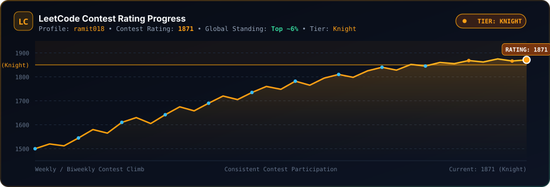
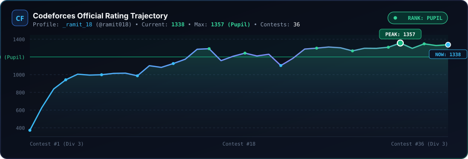
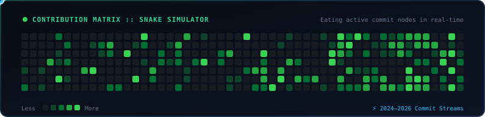
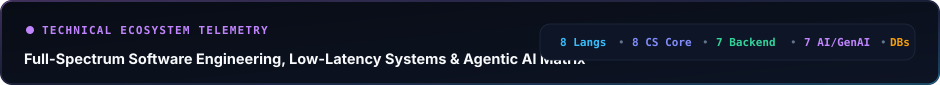
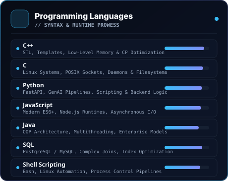
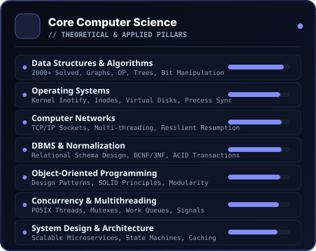
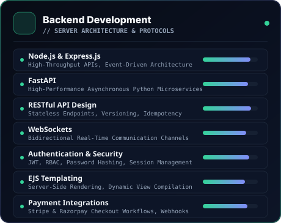
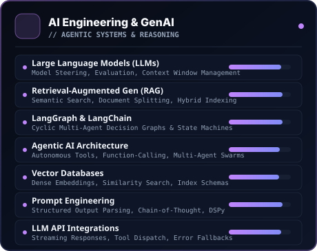
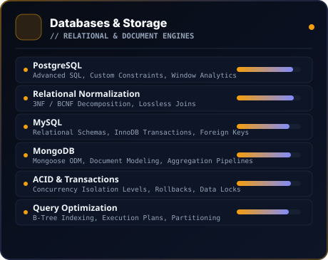
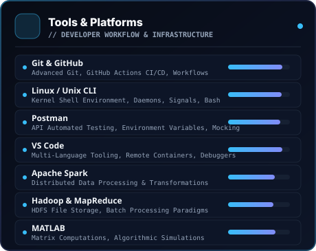

<!-- HERO BANNER -->

  

<!-- QUICK CONNECT SOCIAL BADGES -->

  
  &nbsp;&nbsp;
  
  &nbsp;&nbsp;
  
  &nbsp;&nbsp;
  
  &nbsp;&nbsp;
  

  <b>Bridging Algorithmic Rigor, Low-Latency Distributed Systems &amp; Autonomous Agentic AI</b> 
  Committed to high-performance software engineering, deterministic concurrency, and production-grade architectures.

---

<!-- ========================================== -->
<!-- 01. COMPETITIVE PROGRAMMING DASHBOARD -->
<!-- ========================================== -->

  

<!-- CP DASHBOARD SVG -->

 

<!-- CP VERIFIABLE LINKS & TIERS TABLE -->
<table width="100%">
  <thead>
    <tr>
      <th align="left">Platform</th>
      <th align="center">Contest Rating</th>
      <th align="center">Tier / Badge</th>
      <th align="left">Profile Handle</th>
      <th align="center">Verification</th>
    </tr>
  </thead>
  <tbody>
    <tr>
      <td><b> LeetCode</b></td>
      <td align="center"><code>1871</code></td>
      <td align="center"><b>Knight (Top ~6%)</b></td>
      <td><code>@ramit018</code></td>
      <td align="center"><a href="https://leetcode.com/u/ramit018/"><b>View Profile ↗</b></a></td>
    </tr>
    <tr>
      <td><b> Codeforces</b></td>
      <td align="center"><code>1357</code></td>
      <td align="center"><b>Pupil</b></td>
      <td><code>_ramit_18</code> (@ramit018)</td>
      <td align="center"><a href="https://codeforces.com/profile/ramit018"><b>View Profile ↗</b></a></td>
    </tr>
    <tr>
      <td><b> CodeChef</b></td>
      <td align="center"><code>1582</code></td>
      <td align="center"><b>3-Star ★★★ (Div 2)</b></td>
      <td><code>@ramit018</code></td>
      <td align="center"><a href="https://www.codechef.com/users/ramit018"><b>View Profile ↗</b></a></td>
    </tr>
    <tr>
      <td><b> AtCoder</b></td>
      <td align="center"><code>836</code></td>
      <td align="center"><b>Brown Tier</b></td>
      <td><code>@SR_18</code></td>
      <td align="center"><a href="https://atcoder.jp/users/SR_18"><b>View Profile ↗</b></a></td>
    </tr>
  </tbody>
</table>

 

<!-- LEETCODE CONTEST PROGRESS GRAPH -->
<table width="100%">
  <tr>
    <td width="100%" align="center">
      
<b>📈 LeetCode Contest Rating Trajectory (Peak: 1871 • Knight Tier • Top ~6%)</b>

      
    </td>
  </tr>
</table>

<table width="100%">
  <tr>
    <td width="100%" align="center">
      
    </td>
  </tr>
</table>

 

<!-- CODEFORCES CONTEST RATING TRAJECTORY GRAPH -->
<table width="100%">
  <tr>
    <td width="100%" align="center">
      
<b>📊 Codeforces Official Rating Trajectory (36 Rated Contests • Max: 1357 • Pupil)</b>

      
    </td>
  </tr>
</table>

 

<!-- GITHUB CONTRIBUTION SNAKE ANIMATION (RUNNING ON GREEN DOTS & EATING THEM) -->
<table width="100%">
  <tr>
    <td width="100%" align="center">
      
<b>🐍 Interactive GitHub Contribution Stream &amp; Snake Simulation</b>

      <a href="https://github.com/ramit7707">
        <picture>
          <source media="(prefers-color-scheme: dark)" srcset="https://raw.githubusercontent.com/ramit7707/ramit7707/output/github-contribution-grid-snake-dark.svg">
          <source media="(prefers-color-scheme: light)" srcset="https://raw.githubusercontent.com/ramit7707/ramit7707/output/github-contribution-grid-snake.svg">
          
        </picture>
      </a>
    </td>
  </tr>
</table>

 

<!-- GITHUB STREAK STATS -->
<table width="100%">
  <tr>
    <td width="100%" align="center">
      
    </td>
  </tr>
</table>

 

---

<!-- ========================================== -->
<!-- 02. TECHNICAL ARSENAL -->
<!-- ========================================== -->

  

<!-- ARSENAL TELEMETRY BANNER -->

  

<!-- LARGE-SCALE HIGH-IMPACT SKILL CARDS (2-COLUMN GRID) -->
<table width="100%" border="0" cellspacing="10" cellpadding="0">
  <tr>
    <!-- 1. PROGRAMMING LANGUAGES -->
    <td width="50%" valign="top">
      
    </td>
    <!-- 2. CORE COMPUTER SCIENCE -->
    <td width="50%" valign="top">
      
    </td>
  </tr>
  <tr>
    <!-- 3. BACKEND DEVELOPMENT -->
    <td width="50%" valign="top">
      
    </td>
    <!-- 4. AI ENGINEERING & GENAI -->
    <td width="50%" valign="top">
      
    </td>
  </tr>
  <tr>
    <!-- 5. DATABASES & STORAGE -->
    <td width="50%" valign="top">
      
    </td>
    <!-- 6. TOOLS & PLATFORMS -->
    <td width="50%" valign="top">
      
    </td>
  </tr>
</table>

 

<!-- EXPANDABLE ACCESSIBILITY & ARCHITECTURAL SUMMARY -->

  
<b>🔍 Comprehensive Technical Competency Matrix &amp; Architectural Focus</b>

   
  
  <table width="100%">
    <thead>
      <tr>
        <th align="left" width="22%">Category</th>
        <th align="left" width="38%">Technologies &amp; Frameworks</th>
        <th align="left" width="40%">Architectural &amp; Practical Specialization</th>
      </tr>
    </thead>
    <tbody>
      <tr>
        <td><b>💻 Programming Languages</b></td>
        <td><code>C++</code> • <code>C</code> • <code>Python</code> • <code>JavaScript</code> • <code>Java</code> • <code>MATLAB</code> • <code>SQL</code> • <code>Shell (Bash)</code></td>
        <td>High-performance systems programming, low-overhead memory management, asynchronous runtimes, competitive programming algorithms, and bash automation.</td>
      </tr>
      <tr>
        <td><b>🧠 Core Computer Science</b></td>
        <td><code>Data Structures &amp; Algorithms</code> • <code>OOP</code> • <code>Operating Systems</code> • <code>Computer Networks</code> • <code>DBMS</code> • <code>System Design</code> • <code>Concurrency</code> • <code>Computer Architecture</code></td>
        <td>2000+ solved algorithmic problems, POSIX sockets, Linux kernel <code>inotify</code> subsystems, virtual disk emulators, multithreaded thread pools, and cache hierarchies.</td>
      </tr>
      <tr>
        <td><b>⚙️ Backend Engineering</b></td>
        <td><code>Node.js</code> • <code>Express.js</code> • <code>FastAPI</code> • <code>REST APIs</code> • <code>WebSockets</code> • <code>EJS</code> • <code>JWT &amp; RBAC Auth</code></td>
        <td>Event-driven async microservices, bidirectional socket streaming, stateless endpoint design, idempotency, webhook processing, and payment checkout pipelines.</td>
      </tr>
      <tr>
        <td><b>🤖 AI Engineering &amp; GenAI</b></td>
        <td><code>Large Language Models (LLMs)</code> • <code>RAG</code> • <code>LangGraph</code> • <code>LangChain</code> • <code>Vector DBs</code> • <code>Prompt Engineering</code> • <code>Agentic AI</code></td>
        <td>Autonomous multi-agent orchestration, cyclic state machines, hybrid semantic search, document chunking &amp; embeddings, and deterministic tool-dispatch pipelines.</td>
      </tr>
      <tr>
        <td><b>💾 Databases &amp; Storage</b></td>
        <td><code>PostgreSQL</code> • <code>MySQL</code> • <code>MongoDB</code> • <code>Schema Normalization</code> • <code>Relational Modeling</code> • <code>ACID</code></td>
        <td>Strict 3NF &amp; BCNF decomposition, loss-free relational modeling, multi-table joins, window analytical queries, indexing optimization, and document pipelines.</td>
      </tr>
      <tr>
        <td><b>🛠️ Tools &amp; Platforms</b></td>
        <td><code>Git</code> • <code>GitHub Actions</code> • <code>Linux / Unix CLI</code> • <code>VS Code</code> • <code>Postman</code> • <code>Hadoop</code> • <code>Apache Spark</code> • <code>MATLAB</code></td>
        <td>Git branch strategies, CI/CD automated workflow generation, process signal handling, API regression testing, and distributed batch processing architectures.</td>
      </tr>
    </tbody>
  </table>

 

  Designed &amp; Crafted with precision by <b>Ramit Sherashiya</b> • All contest statistics and ratings verified.

