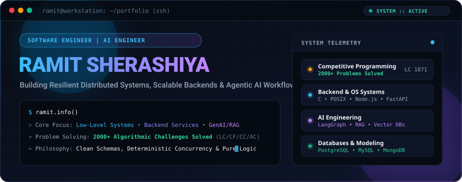
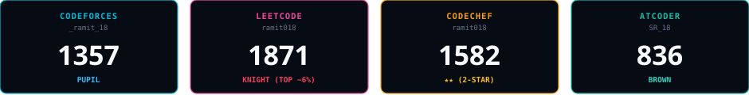
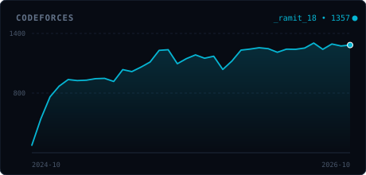
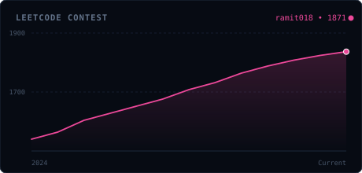
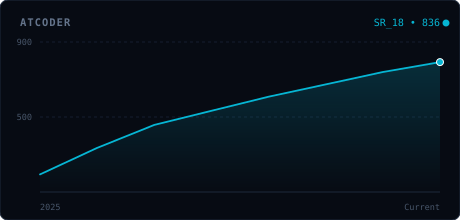
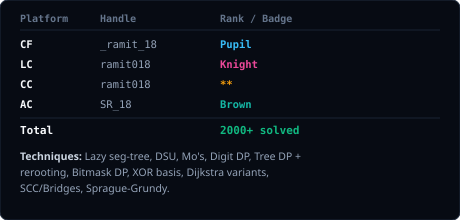
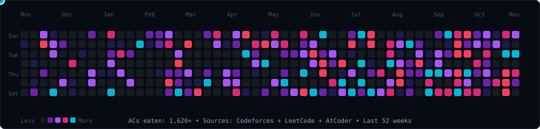
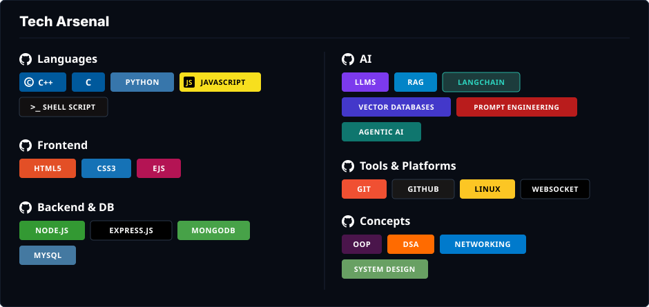

<!-- JUDGE CONSOLE HERO BANNER -->

 

<!-- ========================================== -->
<!-- STANDINGS SECTION -->
<!-- ========================================== -->
## 🏆 Standings

  

<table width="100%">
  <tr>
    <td width="50%" valign="top">
      
    </td>
    <td width="50%" valign="top">
      
    </td>
  </tr>
  <tr>
    <td width="50%" valign="top">
      
    </td>
    <td width="50%" valign="top">
      
    </td>
  </tr>
</table>

 

<!-- ========================================== -->
<!-- CP SNAKE ANIMATION -->
<!-- ========================================== -->
### 🐍 CP Snake: eating my Codeforces + LeetCode + AtCoder accepted submissions (last 12 months)

  Sources: Codeforces API • LeetCode GraphQL • AtCoder Problems API • Updated daily via GitHub Actions

 

<!-- ========================================== -->
<!-- TECH ARSENAL -->
<!-- ========================================== -->

 

  
<b>🔍 View Badges &amp; Quick Links</b>

   

<table width="100%">
  <tr>
    <td width="50%" valign="top">
      <h4> Languages</h4>
      

        
        
        
         
        
      

      <h4> Frontend</h4>
      

        
        
        
      

      <h4> Backend &amp; DB</h4>
      

        
        
         
        
      

    </td>
    <td width="50%" valign="top">
      <h4> AI / ML</h4>
      

        
        
         
        
      

      <h4> Tools &amp; Platforms</h4>
      

        
        
        
        
      

      <h4> Concepts</h4>
      

        
        
         
        
      

    </td>
  </tr>
</table>

 
