

<!-- HERO BANNER -->

  

<!-- QUICK CONNECT SOCIAL BADGES -->

  
  &nbsp;&nbsp;
  
  &nbsp;&nbsp;
  
  &nbsp;&nbsp;
  

  <b>Bridging Algorithmic Rigor, Low-Latency Distributed Systems &amp; Autonomous Agentic AI</b> 
  Committed to high-performance software engineering, deterministic concurrency, and production-grade architectures.

---

<!-- ========================================== -->
<!-- 01. COMPETITIVE PROGRAMMING DASHBOARD -->
<!-- ========================================== -->
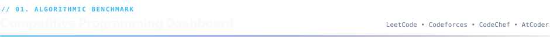

  

<!-- CP DASHBOARD SVG -->
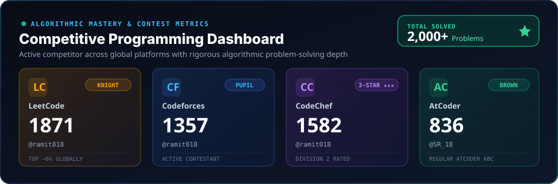

 

<!-- CP VERIFIABLE LINKS & TIERS TABLE -->
<table width="100%">
  <thead>
    <tr>
      <th align="left">Platform</th>
      <th align="center">Contest Rating</th>
      <th align="center">Tier / Badge</th>
      <th align="left">Profile Handle</th>
      <th align="center">Verification</th>
    </tr>
  </thead>
  <tbody>
    <tr>
      <td><b> LeetCode</b></td>
      <td align="center"><code>1871</code></td>
      <td align="center"><b>Knight (Top ~6%)</b></td>
      <td><code>@ramit018</code></td>
      <td align="center"><a href="https://leetcode.com/u/ramit018/"><b>View Profile ↗</b></a></td>
    </tr>
    <tr>
      <td><b> Codeforces</b></td>
      <td align="center"><code>1357</code></td>
      <td align="center"><b>Pupil</b></td>
      <td><code>@ramit018</code></td>
      <td align="center"><a href="https://codeforces.com/profile/ramit018"><b>View Profile ↗</b></a></td>
    </tr>
    <tr>
      <td><b> CodeChef</b></td>
      <td align="center"><code>1582</code></td>
      <td align="center"><b>3-Star ★★★ (Div 2)</b></td>
      <td><code>@ramit018</code></td>
      <td align="center"><a href="https://www.codechef.com/users/ramit018"><b>View Profile ↗</b></a></td>
    </tr>
    <tr>
      <td><b> AtCoder</b></td>
      <td align="center"><code>836</code></td>
      <td align="center"><b>Brown Tier</b></td>
      <td><code>@SR_18</code></td>
      <td align="center"><a href="https://atcoder.jp/users/SR_18"><b>View Profile ↗</b></a></td>
    </tr>
  </tbody>
</table>

 

<!-- GITHUB CONTRIBUTION & COMMIT METRICS -->
<table width="100%">
  <tr>
    <td width="100%" align="center">
      
<b>📊 GitHub Year-Round Contribution Activity</b>

      
    </td>
  </tr>
</table>

<table width="100%">
  <tr>
    <td width="100%" align="center">
      
    </td>
  </tr>
</table>

 

---

<!-- ========================================== -->
<!-- 02. TECHNICAL ARSENAL -->
<!-- ========================================== -->
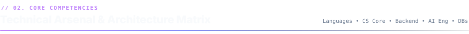

  

<!-- SKILLS GRID (3x2 DISPLAY) -->
<table width="100%" border="0" cellspacing="8" cellpadding="0">
  <tr>
    <td width="50%" valign="top">
      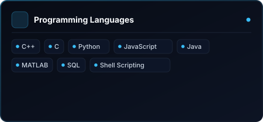
    </td>
    <td width="50%" valign="top">
      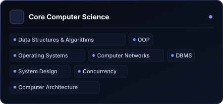
    </td>
  </tr>
  <tr>
    <td width="50%" valign="top">
      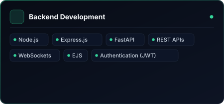
    </td>
    <td width="50%" valign="top">
      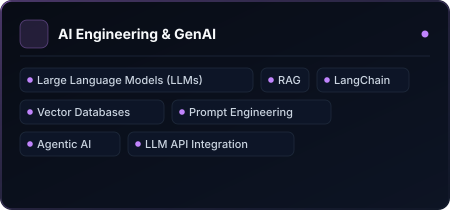
    </td>
  </tr>
  <tr>
    <td width="50%" valign="top">
      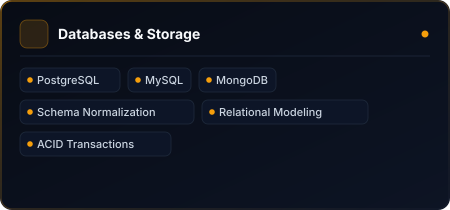
    </td>
    <td width="50%" valign="top">
      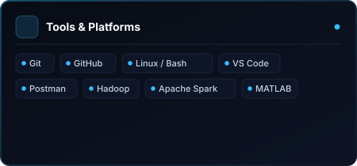
    </td>
  </tr>
</table>

  
<b>🔍 Text Summary &amp; Competency Index (Accessible for Screen Readers &amp; Search)</b>

   
  <ul>
    <li><b>Programming Languages:</b> C++, C, Python, JavaScript, Java, MATLAB, SQL, Shell Scripting (Bash)</li>
    <li><b>Core Computer Science:</b> Data Structures &amp; Algorithms, Object-Oriented Programming (OOP), Operating Systems (Linux Internals), Computer Networks (Socket Programming, TCP/IP), Database Management Systems (DBMS), System Design, Concurrency &amp; Multithreading (POSIX pthreads), Computer Architecture</li>
    <li><b>Backend Development:</b> Node.js, Express.js, FastAPI, RESTful APIs, WebSockets, EJS, Authentication (JWT, Session Management, RBAC)</li>
    <li><b>Databases &amp; Storage:</b> PostgreSQL (3NF/BCNF Decomposition, Relational Modeling, Window Functions), MySQL, MongoDB (Mongoose ODM, Document Aggregations)</li>
    <li><b>AI Engineering &amp; Generative AI:</b> Large Language Models (LLMs), Retrieval-Augmented Generation (RAG), LangChain, LangGraph Workflows, Vector Databases, Prompt Engineering, Autonomous Agentic AI, Multi-Agent Coordination, LLM API Integration</li>
    <li><b>Tools &amp; Platforms:</b> Git, GitHub, Linux / Unix CLI, VS Code, Postman, Hadoop, Apache Spark, MATLAB</li>
  </ul>

 

---

<!-- ========================================== -->
<!-- 03. FEATURED ENGINEERING SHOWCASE -->
<!-- ========================================== -->
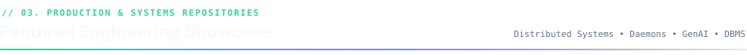

  

<!-- PROJECT CARD ROW 1 -->
<table width="100%">
  <tr>
    <!-- PROJECT 1: AI PROJECT ANALYZER -->
    <td width="50%" valign="top">
      
        
      <b>🤖 AI Software Project Health &amp; Risk Analyzer</b> 
      Autonomous Multi-Agent Repository Intelligence Platform
      

        An autonomous analysis platform that inspects software repositories, tracking commit churn, PR cycle velocity, contributor dynamics, and open issues. Employs <b>LangGraph multi-agent workflows</b> to synthesize complex metrics into automated executive health and delivery risk reports.
      

      <ul>
        <li><b>LangGraph State Machine:</b> Orchestrates autonomous reasoning agents to identify code delivery bottlenecks and velocity regression.</li>
        <li><b>GitHub REST Ingestion:</b> Pulls real-time pull requests, commit diffs, and issue timelines into structured MongoDB collections.</li>
        <li><b>Executive Intelligence:</b> Generates automated risk mitigation reports and predictive project health indicators.</li>
      </ul>
      

        <code>Python</code> • <code>LangGraph</code> • <code>LangChain</code> • <code>FastAPI</code> • <code>MongoDB</code> • <code>LLM APIs</code>
      

      

        🔗 <a href="https://github.com/ramit7707/Ai-Software-Project-Health-and-Risk-Analyzer"><b>View Source Code on GitHub ↗</b></a>
      

    </td>

    <!-- PROJECT 2: CN FILE DISTRIBUTION -->
    <td width="50%" valign="top">
      
        
      <b>🌐 Fault-Tolerant Topic File Distribution Service</b> 
      High-Throughput Resilient TCP Distribution Daemon in C
      

        A multi-version TCP-based file distribution system in C implementing topic-based directory routing. Progresses from a baseline multithreaded server to a fault-resilient architecture featuring probabilistic drop injection, session state tracking, byte-offset checkpoints, and parallel worker queues.
      

      <ul>
        <li><b>Deterministic Byte Resumption:</b> Saves transfer offset states allowing interrupted file streams to resume immediately without re-transferring.</li>
        <li><b>Worker Thread Pool:</b> Coordinates concurrent topic requests using POSIX threads and synchronization primitives.</li>
        <li><b>Parallel Worker Queue:</b> Distributes individual file chunks across parallel TCP connections for maximized bandwidth saturation.</li>
      </ul>
      

        <code>C</code> • <code>TCP/IP Sockets</code> • <code>POSIX Threads (pthreads)</code> • <code>Network Protocols</code> • <code>Fault Recovery</code>
      

      

        🔗 <a href="https://github.com/ramit7707/CN-Project"><b>View Source Code on GitHub ↗</b></a>
      

    </td>
  </tr>
</table>

 

<!-- ARCHITECTURE FLOW VISUALIZATION -->

  
<b>📐 View Architecture Workflow: Fault-Tolerant Topic Distribution Service</b>

   

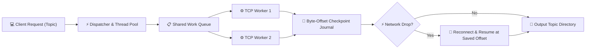

 

<!-- PROJECT CARD ROW 2 -->
<table width="100%">
  <tr>
    <!-- PROJECT 3: FOREVER E-COMMERCE -->
    <td width="50%" valign="top">
      
        
      <b>🛍️ Forever — Full-Stack E-Commerce Platform</b> 
      MERN Architecture with Dual Payment Gateways &amp; Admin Panel
      

        A production-ready commercial application comprising a responsive customer storefront, a dedicated admin inventory dashboard, and a secure Node.js/Express REST API supporting multi-size variants and dual payment gateways.
      

      <ul>
        <li><b>Dual Payment Gateways:</b> Seamless integration of both <b>Stripe</b> and <b>Razorpay</b> checkout pipelines with webhook verification.</li>
        <li><b>Variant &amp; Cart State:</b> Per-size variant inventory tracking, dynamic cart synchronization, and Cloudinary image pipelines.</li>
        <li><b>Role-Based Auth:</b> Secure JWT-based customer sessions paired with isolated administrative access control.</li>
      </ul>
      

        <code>Node.js</code> • <code>Express.js</code> • <code>MongoDB</code> • <code>React 19</code> • <code>Tailwind CSS</code> • <code>Stripe</code> • <code>Razorpay</code>
      

      

        🌐 <a href="https://e-commerce-lemon-two-96.vercel.app/" target="_blank"><b>Live Interactive Demo ↗</b></a> &nbsp;|&nbsp; 🔗 <a href="https://github.com/ramit7707/e-commerce"><b>View GitHub Repo ↗</b></a>
      

    </td>

    <!-- PROJECT 4: SIMPLE FILE SYSTEM -->
    <td width="50%" valign="top">
      
        
      <b>📁 Simple File System (SFS) Simulator</b> 
      Unix-Inspired Virtual Disk &amp; Inode Architecture in C
      

        A low-level operating system storage simulator built in pure C that emulates a Unix file system on a raw virtual disk (`sfs.disk`). Demonstrates fundamental OS concepts including superblock layout, inode indexing, and block bitmap allocation.
      

      <ul>
        <li><b>Virtual Disk Storage:</b> Simulates physical disk blocks with binary serialization across virtual disk sectors.</li>
        <li><b>Inode &amp; Bitmap Management:</b> Implements block allocation tables, free-space bitmaps, and inode metadata attributes.</li>
        <li><b>Hierarchical CLI:</b> Supports directory creation (`md`), navigation (`cd`), file read/write (`create`, `dis`), and disk diagnostics.</li>
      </ul>
      

        <code>C</code> • <code>Systems Programming</code> • <code>Unix Inodes</code> • <code>Disk I/O</code> • <code>File Systems</code> • <code>Data Structures</code>
      

      

        🔗 <a href="https://github.com/ramit7707/Simple-file-system"><b>View Source Code on GitHub ↗</b></a>
      

    </td>
  </tr>
</table>

 

<!-- PROJECT CARD ROW 3 -->
<table width="100%">
  <tr>
    <!-- PROJECT 5: BACKUP DAEMON -->
    <td width="50%" valign="top">
      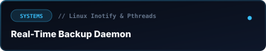
        
      <b>⚙️ Real-Time Automatic Backup Daemon</b> 
      Kernel Inotify &amp; POSIX Multithreaded Linux Daemon in C
      

        An asynchronous Linux background daemon engineered for automated directory monitoring and real-time incremental file replication using kernel filesystem notifications.
      

      <ul>
        <li><b>Linux Inotify Subsystem:</b> Traps kernel-level filesystem events (`IN_CREATE`, `IN_MODIFY`, `IN_DELETE`) with near-zero CPU overhead.</li>
        <li><b>Thread-Safe Concurrency:</b> Decouples event listening from disk replication via worker thread pools and mutex-synchronized queues.</li>
        <li><b>Daemon Lifecycle:</b> Features background process detachment, signal handling (`SIGINT`, `SIGTERM`), and atomic activity logging.</li>
      </ul>
      

        <code>C</code> • <code>Linux System Programming</code> • <code>Inotify API</code> • <code>POSIX Threads</code> • <code>Signal Handling</code> • <code>Daemons</code>
      

      

        🔗 <a href="https://github.com/ramit7707/Csp-Project"><b>View Source Code on GitHub ↗</b></a>
      

    </td>

    <!-- PROJECT 6: STAYBNB RELATIONAL DBMS -->
    <td width="50%" valign="top">
      
        
      <b>🏨 Staybnb Rental Services Database Engine</b> 
      PostgreSQL Relational Schema Decomposed to 3NF &amp; BCNF
      

        A fully normalized enterprise relational database architecture engineered for an online peer-to-peer lodging marketplace, modeling hosts, properties, seasonal pricing, guest reservations, and multi-faceted review structures.
      

      <ul>
        <li><b>Strict Normalization (3NF / BCNF):</b> Eliminates transitive functional dependencies and update anomalies across all entity relationships.</li>
        <li><b>ACID Transaction Integrity:</b> Enforces reservation calendar non-overlap constraints, foreign key referential integrity, and cascading checks.</li>
        <li><b>Analytical SQL Engine:</b> Features complex multi-table joins, subqueries, and window functions for booking density and host revenue analysis.</li>
      </ul>
      

        <code>PostgreSQL</code> • <code>Advanced SQL</code> • <code>Database Normalization</code> • <code>Relational Schema Design</code> • <code>ACID</code>
      

      

        🔗 <a href="https://github.com/ramit7707/Stay-bnb"><b>View Source Code on GitHub ↗</b></a>
      

    </td>
  </tr>
</table>

 

---

<!-- ========================================== -->
<!-- 04. KEY HONORS & ACHIEVEMENTS -->
<!-- ========================================== -->

  

<!-- ACHIEVEMENTS CARD SVG -->
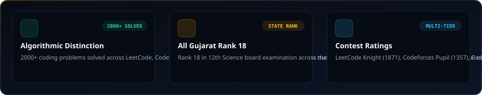

  

<table width="100%">
  <tr>
    <td width="33.3%" valign="top">
      <b>🏆 2000+ Algorithmic Problems Solved</b> 
      Mastery across global competitive platforms
      

        Solved over 2,000 algorithmic challenges spanning graph theory, dynamic programming, combinatorics, bit manipulation, and advanced data structures across LeetCode, Codeforces, CodeChef, and AtCoder.
      

    </td>
    <td width="33.3%" valign="top">
      <b>🎓 All Gujarat Rank 18</b> 
      Scholastic state-level distinction
      

        Ranked <b>18th across Gujarat State</b> in the 12th Science board examination among hundreds of thousands of candidates, reflecting sustained discipline, rigorous analytical focus, and mathematical grounding.
      

    </td>
    <td width="33.3%" valign="top">
      <b>⚡ High-Tier Contest Standing</b> 
      Active global competitor ratings
      

        Achieved <b>LeetCode Knight (1871 rating, top ~6% globally)</b>, <b>CodeChef 3-Star (1582, Division 2)</b>, <b>Codeforces Pupil (1357)</b>, and <b>AtCoder Brown (836)</b> with verifiable public performance records.
      

    </td>
  </tr>
</table>

 

---

<!-- ========================================== -->
<!-- 05. CURRENT HORIZONS & RESEARCH -->
<!-- ========================================== -->

  

<!-- EXPLORING CARD SVG -->
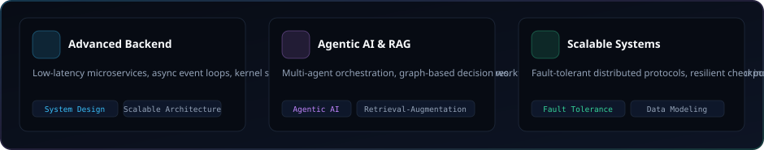

  

<table width="100%">
  <tr>
    <td width="33.3%" valign="top">
      <b>⚡ Advanced Backend &amp; Concurrency</b>
      <ul>
        <li>High-throughput, event-driven async network backends</li>
        <li>Low-latency microservices with non-blocking I/O</li>
        <li>POSIX thread pool scheduling &amp; lock-free algorithms</li>
        <li>Large-scale distributed systems and partition resilience</li>
      </ul>
    </td>
    <td width="33.3%" valign="top">
      <b>🤖 Agentic AI &amp; GenAI Architecture</b>
      <ul>
        <li>Graph-based multi-agent orchestration (LangGraph)</li>
        <li>Hybrid lexical &amp; semantic vector search pipelines</li>
        <li>Self-correcting Retrieval-Augmented Generation (RAG)</li>
        <li>Deterministic LLM tool-calling and workflow synthesis</li>
      </ul>
    </td>
    <td width="33.3%" valign="top">
      <b>🏗️ Scalable Architecture &amp; Data</b>
      <ul>
        <li>Database sharding, replication &amp; caching strategies</li>
        <li>Clean domain-driven system design patterns</li>
        <li>Deterministic state machines &amp; checkpoint journaling</li>
        <li>Fault-tolerant distributed consensus concepts</li>
      </ul>
    </td>
  </tr>
</table>

 

---

<!-- ========================================== -->
<!-- 06. CONNECT & COLLABORATE -->
<!-- ========================================== -->
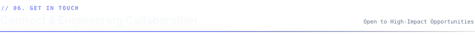

  

  <table width="85%">
    <tr>
      <td align="center">
        <h3>🤝 Let's Build Something Impactful Together</h3>
        

          I am always open to discussing <b>backend engineering</b>, <b>low-level systems architecture</b>, <b>algorithmic problem solving</b>, and <b>production-grade AI engineering</b> opportunities. Feel free to connect or drop a message!
        

        

          
          &nbsp;&nbsp;
          
          &nbsp;&nbsp;
          
        

         
        Designed &amp; Crafted with precision by <b>Ramit Sherashiya</b> • All stats and repository references verified.
      </td>
    </tr>
  </table>

